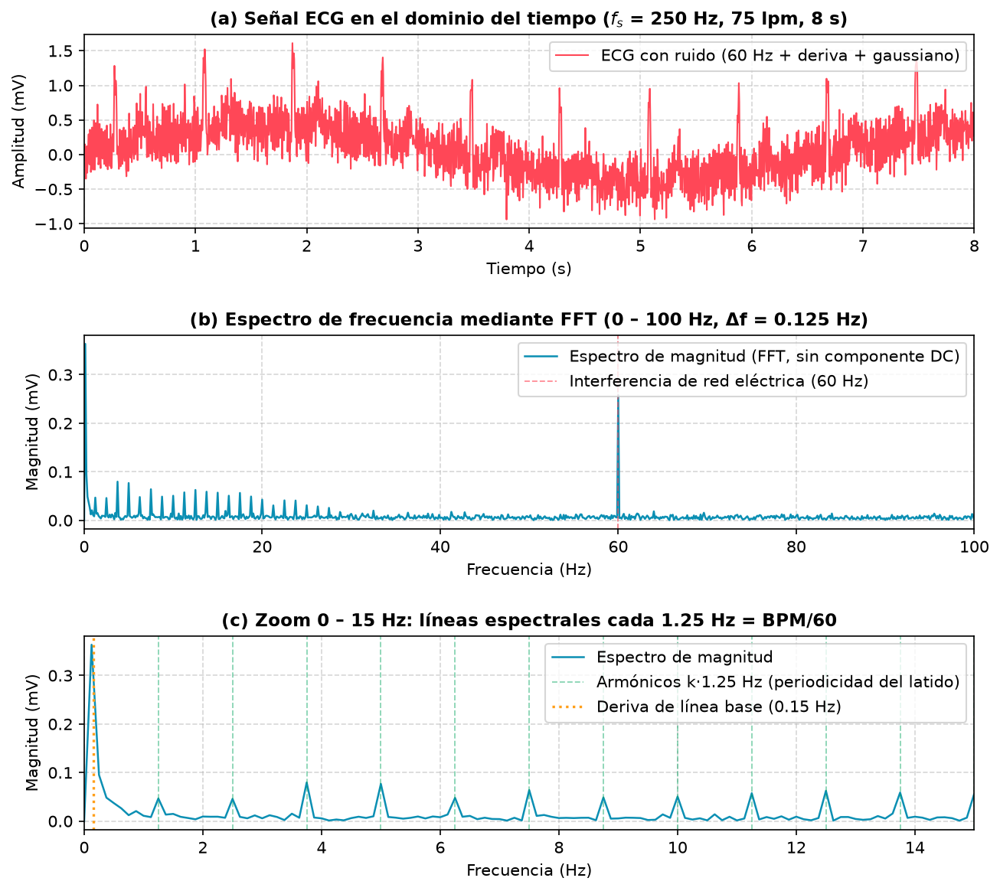
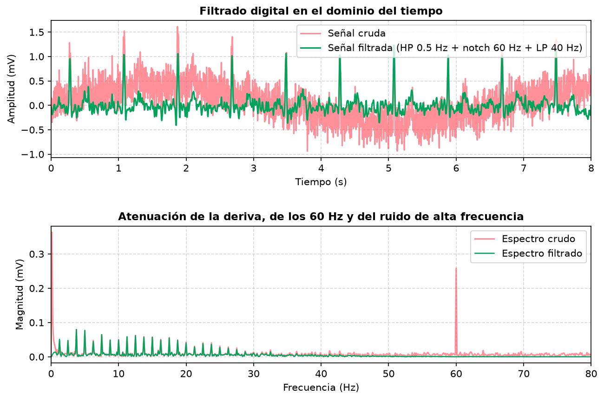

# Simulación y adquisición de ECG: análisis en frecuencia y filtrado digital

**Asignatura:** Teoría de Señales · Universidad de Manizales

> Este archivo es la puerta de entrada al repositorio (Entrega 2). El manual técnico completo del sistema está en [`ecg-signal-simulator/README.md`](ecg-signal-simulator/README.md).

## 1. Nombre del proyecto e integrantes

**Proyecto:** Simulador y adquisición de electrocardiograma (ECG) con Arduino, análisis FFT y filtrado digital.

**Integrantes:**
* Jerónimo Soto Villada
* Milady Cristina Guapacha Montoya

**Demo web (se abre desde el celular):** <https://teoria-de-senales-ecg-arduino.vercel.app> (publicada en Vercel; configuración en [`vercel.json`](vercel.json) y pasos en [`ecg-signal-simulator/README.md`, sección 6](ecg-signal-simulator/README.md)).
**Presentación:** [`ecg-signal-simulator/docs/Presentacion_ECG_Arduino.pdf`](ecg-signal-simulator/docs/Presentacion_ECG_Arduino.pdf)

## 2. Descripción breve

Se estudia el **electrocardiograma (ECG)**: una señal bioeléctrica analógica, de banda limitada (≈ 0.5–100 Hz) y casi periódica, que llega contaminada por deriva de línea base (< 0.5 Hz), interferencia de la red eléctrica (60 Hz) y ruido de alta frecuencia.

**Objetivo del sistema:** generar o adquirir un ECG, muestrearlo, representarlo en el tiempo, analizar su contenido en frecuencia (FFT), filtrarlo y calcular la frecuencia cardíaca (BPM = 60 / intervalo RR). La señal puede venir de un generador matemático o de un Arduino Uno con el módulo AD8232; un servidor Node.js la distribuye en tiempo real a una página web.

> Proyecto con fines educativos. No es un dispositivo médico ni sirve para diagnosticar.

## 3. Estado actual

| Parte | Estado |
|---|---|
| Generador de ECG sintético (5 gaussianas P-Q-R-S-T) con controles de BPM, amplitud, ruido, red de 60 Hz y deriva | ✅ Funciona (navegador) |
| Visualización en tiempo real (canvas, fs = 250 Hz) | ✅ Funciona |
| Filtros digitales: pasa-altas 0.5 Hz, notch 60 Hz, pasa-bajas 40 Hz | ✅ Funciona; respuesta en frecuencia comprobada con pruebas automáticas |
| Detector de latidos Pan-Tompkins y BPM | ✅ Funciona: error ≤ 2 lpm entre 40 y 180 lpm (señal normal); ≤ 3 lpm con ruido, 60 Hz y deriva |
| Análisis FFT, caracterización y filtrado con SciPy (`scripts/analisis_fft.py`) | ✅ Funciona y es reproducible (semilla fija) |
| Servidor Node.js + Express + Sequelize + MySQL: usuarios e historial de BPM | ✅ Funciona (24 pruebas automáticas pasan) |
| Enlace con Arduino por puerto serial (protocolo propio, comandos con confirmación) | ✅ Detección automática del puerto, mensajes cuando el Arduino IDE lo ocupa y botón para liberarlo. Probado con el Arduino simulado y con el protocolo del sketch; **pendiente:** validar con el AD8232 y electrodos reales |
| Sketch `ecg_plotter_teoria.ino` (Serial Plotter del IDE + página) | ✅ Compila para Arduino Uno (39 % de memoria de programa). Modo gráfica con derivaciones, FC, ritmo y QRS; modo web a 250 Hz que la página activa sola |
| Arduino por USB directo desde el navegador (Web Serial) | ✅ Funciona en la versión publicada (Chrome/Edge de computador) |
| Interfaz «glass» adaptada a celulares | ✅ Barra inferior, monitor nítido en pantallas de alta densidad, controles táctiles de 44 px |
| Señales reales de bases de datos (p. ej. MIT-BIH) | ⏳ Falta: comparar el detector con registros anotados |
| Filtros de mayor orden / comparación IIR vs. FIR / variabilidad de la frecuencia cardíaca | ⏳ Falta |

## 4. Datos o recursos

* **Señal sintética generada por código** (no se descarga ninguna base de datos): suma de cinco gaussianas por latido, con ruido gaussiano, interferencia de 60 Hz y deriva de 0.15 Hz. El modelo sigue la idea de McSharry et al. (2003), referencia 2. Parámetros del ruido: gaussiano σ = 0.15 mV, red 0.25 mV a 60 Hz, deriva 0.40 mV a 0.15 Hz.
* **Muestra pequeña para probar el código:** [`ecg-signal-simulator/data/muestra_ecg_sintetico.json`](ecg-signal-simulator/data/muestra_ecg_sintetico.json) (2 s, 500 muestras a 250 Hz, 75 lpm, sin ruido). Se regenera con `scripts/analisis_fft.py`.
* **Sensor (opcional):** Arduino Uno + módulo AD8232 (ADC de 10 bits en A0, ≈ 225 cuentas por mV). Cableado y sketch en [`ecg-signal-simulator/arduino/`](ecg-signal-simulator/arduino/).
* **Frecuencia de muestreo:** fs = 250 Hz (Ts = 4 ms, Nyquist = 125 Hz). El contenido útil del ECG llega a ≈ 100 Hz y la interferencia de 60 Hz queda por debajo de Nyquist, así que no hay aliasing; además, 250 Hz es un valor habitual en equipos educativos de ECG.

## 5. Cómo ejecutar

**Software:** Node.js ≥ 18 (probado con 22 y 24), Python 3.10 o superior, VS Code (opcional). Solo para usuarios e historial: XAMPP con MySQL. Solo para el sensor real: Arduino IDE (sketch [`arduino/ecg_plotter_teoria`](ecg-signal-simulator/arduino/)).

**A. Análisis de señales en Python (no necesita nada más):**
```bash
pip install -r requirements.txt
cd ecg-signal-simulator
python scripts/analisis_fft.py      # genera results/*.png, results/caracterizacion.md y data/*.json
```

**B. Simulador web con servidor (usuarios, historial, Arduino):**
```bash
npm --prefix ./ecg-signal-simulator install
cp ecg-signal-simulator/.env.example ecg-signal-simulator/.env     # Windows: Copy-Item
# Abrir XAMPP → Start en MySQL. Luego, desde la raíz del repositorio:
npm start                                                          # abre http://localhost:3000
```

El Arduino IDE puede quedar abierto, pero **cierra su Serial Plotter / Monitor Serie** antes de `npm start`: un puerto USB lo usa un solo programa. La terminal muestra la dirección para abrir la página desde un celular en el mismo Wi-Fi.

**C. Solo el simulador, sin servidor ni base de datos:** la página publicada en Vercel, o `ecg-signal-simulator/src/public/index.html` con *Live Server*. Funciona en «versión web»: simulador, filtros y Arduino por USB directo (Chrome/Edge).

**D. Pruebas automáticas:** `npm test` (30 pruebas; las 9 de la API necesitan MySQL encendido). Solo las de procesamiento de señales: `cd ecg-signal-simulator && node --test tests/detector.test.js`.

## 6. Conceptos de Teoría de Señales utilizados hasta el momento

* **Señales continuas y discretas, muestreo, Ts = 1/fs, Nyquist y aliasing:** el ECG analógico se convierte en x[n] con el ADC o con el generador.
* **Cuantización:** ADC de 10 bits → ≈ 4.4 µV por cuenta.
* **Periodicidad:** periodo del latido T = 60/BPM y frecuencia fundamental f = BPM/60 (75 lpm → 0.8 s → 1.25 Hz).
* **Análisis frecuencial (DFT/FFT):** resolución Δf = fs/N, espectro de magnitud de una cara, armónicos de una señal periódica no sinusoidal, **fuga espectral** (por eso el análisis usa 8 s = 10 latidos exactos).
* **Ruido e interferencia:** gaussiano (banda ancha), sinusoidal de 60 Hz (línea espectral) y deriva (baja frecuencia).
* **Sistemas LTI y filtros digitales IIR:** ecuaciones en diferencias del pasa-altas y del pasa-bajas de 1.er orden, notch con ceros en el círculo unidad, Butterworth de 2.º orden y filtrado de fase cero (`filtfilt`) en Python.
* **Detección de eventos:** pasa-banda, derivada, cuadrado, integración en ventana móvil y umbral adaptativo (Pan-Tompkins).

Desarrollo matemático completo en [`ecg-signal-simulator/docs/teoria_senales.md`](ecg-signal-simulator/docs/teoria_senales.md).

## 7. Resultados actuales

Señal de ejemplo: 75 lpm, fs = 250 Hz, 8 s (N = 2000), Δf = 0.125 Hz. Valores numéricos en [`results/caracterizacion.md`](ecg-signal-simulator/results/caracterizacion.md) y explicación detallada en [`results/README_resultados.md`](ecg-signal-simulator/results/README_resultados.md).

### Figura 1: dominio del tiempo y de la frecuencia


* **(a) Tiempo:** se ven 10 picos R separados 0.8 s; la línea base oscila ≈ ±0.5 mV por la deriva y el zumbido de 60 Hz con el ruido gaussiano tapan las ondas P y T.
* **(b) FFT 0–100 Hz:** una línea aislada de ≈ 0.26 mV en 60 Hz (la red inyectada es de 0.25 mV), un máximo cerca de 0 Hz (la deriva, ≈ 0.36 mV) y una «peineta» de líneas que decae hasta ≈ 30 Hz.
* **(c) Zoom 0–15 Hz:** las líneas están en múltiplos de **1.25 Hz** = BPM/60. La fundamental mide ≈ 0.05 mV y los armónicos de 3.75 y 5.0 Hz ≈ 0.08 mV, porque el QRS es angosto y reparte su energía en muchos armónicos. La FFT recupera **1.250 Hz → 75.0 lpm**.

### Figura 2: filtrado digital (pasa-altas 0.5 Hz → notch 60 Hz → pasa-bajas 40 Hz)


* Desaparecen la deriva y la línea de 60 Hz y se conservan las líneas del ECG entre 1 y 30 Hz.
* El RMS del error respecto a la señal limpia baja de **0.368 mV a 0.083 mV**.
* El pico R filtrado baja de ≈ 1.2–1.6 mV a ≈ 1.0 mV: limpiar el ruido cuesta algo de amplitud del QRS.

### Validación
* **24 pruebas automáticas** (puente Arduino, API, detector de latidos, continuidad del generador y respuesta de los filtros).
* El detector mide el BPM con error ≤ 2 lpm entre 40 y 180 lpm. Limitación conocida: con relación señal/ruido muy baja (amplitud 0.3× con ruido de 30 %) puede equivocarse.

## 8. Referencias

1. Pan, J., & Tompkins, W. J. (1985). A real-time QRS detection algorithm. *IEEE Transactions on Biomedical Engineering, BME-32*(3), 230–236.
2. McSharry, P. E., Clifford, G. D., Tarassenko, L., & Smith, L. A. (2003). A dynamical model for generating synthetic electrocardiogram signals. *IEEE Transactions on Biomedical Engineering, 50*(3), 289–294.
3. Oppenheim, A. V., & Schafer, R. W. (2010). *Discrete-Time Signal Processing* (3rd ed.). Pearson.
4. Cooley, J. W., & Tukey, J. W. (1965). An algorithm for the machine calculation of complex Fourier series. *Mathematics of Computation, 19*(90), 297–301.
5. Moody, G. B., & Mark, R. G. (2001). The impact of the MIT-BIH Arrhythmia Database. *IEEE Engineering in Medicine and Biology Magazine, 20*(3), 45–50.
6. Analog Devices. *AD8232: Single-Lead, Heart Rate Monitor Front End* (hoja de datos).

## Estructura del repositorio

```
.
├── README.md                    ← este archivo
├── requirements.txt             ← dependencias de Python
├── .gitignore
├── vercel.json                  ← publica la demo web en Vercel (sitio estático)
└── ecg-signal-simulator/
    ├── src/                     ← código principal (servidor Node.js y web)
    ├── data/                    ← muestra pequeña de ECG (JSON)
    ├── results/                 ← gráficas, tabla de caracterización e interpretación
    ├── docs/                    ← teoría y presentación
    ├── scripts/                 ← análisis FFT (Python) y utilidades
    ├── tests/                   ← pruebas automáticas
    ├── arduino/                 ← sketch ecg_plotter_teoria (Serial Plotter + página)
    └── database/                ← esquema SQL
```
No se usan *notebooks* de Jupyter: el análisis está en un script de Python (`scripts/analisis_fft.py`).

## Licencia
MIT (ver [`ecg-signal-simulator/LICENSE`](ecg-signal-simulator/LICENSE)).
