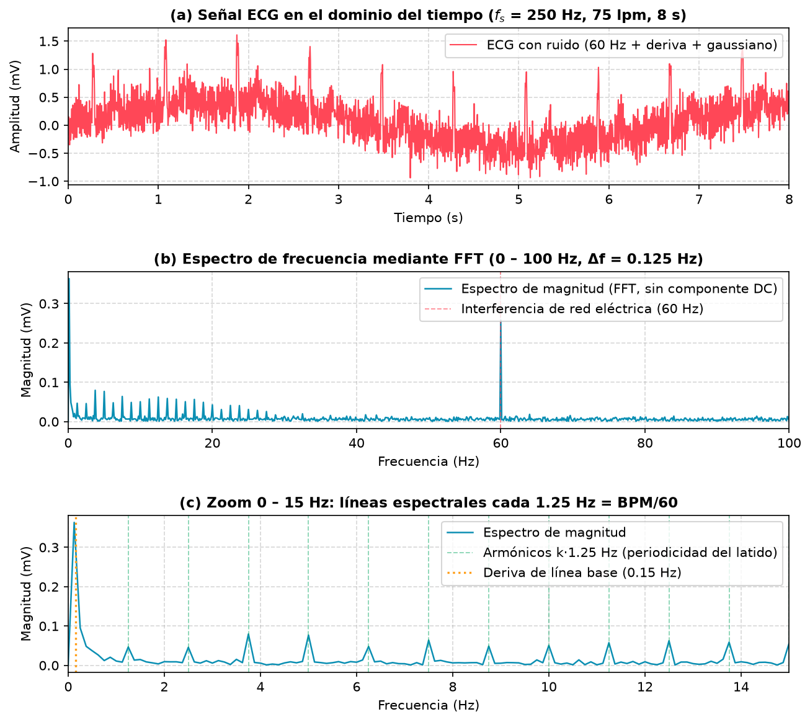
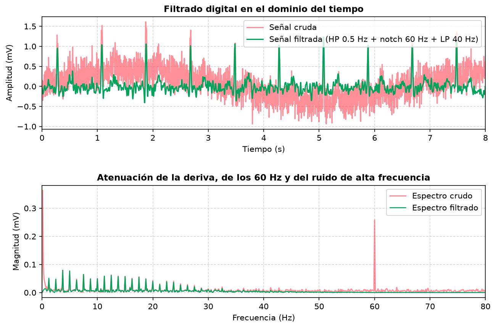

# Resultados y análisis frecuencial

Estas figuras y tablas las genera `scripts/analisis_fft.py` (`python scripts/analisis_fft.py` desde la carpeta del proyecto). Con la semilla fija (`SEMILLA = 42`) el resultado es idéntico en cada ejecución.

**Señal analizada:** ECG sintético de 75 lpm, fs = 250 Hz (Ts = 4 ms), 8 s → N = 2000 muestras, Δf = fs/N = 0.125 Hz.
**Degradaciones añadidas:** ruido gaussiano σ = 0.15 mV, interferencia de red 0.25 mV a 60 Hz y deriva de línea base 0.40 mV a 0.15 Hz. Valores numéricos completos en [`caracterizacion.md`](caracterizacion.md).

## 1. Dominio del tiempo y de la frecuencia (`ecg_time_and_fft.png`)

**Qué muestra cada panel**

* **(a) Tiempo.** Se distinguen 10 picos R (≈ 1.2 mV, hasta 1.6 mV con el ruido) separados 0.8 s, pero la línea base «respira» entre ≈ −0.5 y +0.5 mV por la deriva, y el zumbido de 60 Hz junto con el ruido gaussiano tapan las ondas P y T.
* **(b) FFT, 0–100 Hz.** Hay tres cosas: un máximo a muy baja frecuencia (≈ 0.36 mV en 0.125 Hz, la deriva), una línea aislada de ≈ 0.26 mV en **60 Hz** (la red; su amplitud real es 0.25 mV) y una «peineta» de líneas decrecientes hasta ≈ 30 Hz.
* **(c) Zoom 0–15 Hz.** Las líneas están exactamente a múltiplos de **1.25 Hz** = BPM/60. Esa separación es la huella de la periodicidad: periodo 0.8 s ↔ líneas cada 1/0.8 = 1.25 Hz.

**Interpretación**

1. La **fundamental** (1.25 Hz, ≈ 0.047 mV) existe pero *no es* la línea más alta: las más grandes son los armónicos de 3.75 y 5.0 Hz (≈ 0.08 mV). Es normal en un ECG, porque el QRS es una onda angosta (≈ 25 ms) y su energía se reparte en muchos armónicos. Por eso el BPM se obtiene del espaciamiento de las líneas (o del intervalo RR), no de «la línea más alta».
2. El **máximo cerca de 0 Hz** no es el latido: es la deriva de línea base (0.15 Hz), más ancha que un bin porque 8 s contienen solo 1.2 de sus periodos (fuga espectral).
3. Midiendo la línea más alta en la banda 0.7–3.5 Hz se obtiene **1.250 Hz → 75.0 lpm**, igual al valor nominal.
4. Con fs = 250 Hz, la frecuencia de Nyquist es 125 Hz; el ECG relevante (< 100 Hz) y el tono de 60 Hz quedan por debajo, sin *aliasing*.

---

## 2. Desempeño del filtrado digital (`ecg_filtering_analysis.png`)

Cadena aplicada (SciPy, `filtfilt` → fase cero): pasa-altas Butterworth 0.5 Hz → notch 60 Hz (Q = 30) → pasa-bajas Butterworth 40 Hz.

* **Tiempo (arriba).** La señal verde queda centrada en 0 (sin deriva), sin el zumbido de 60 Hz, y se ven con claridad los 10 picos R y las ondas T.
* **Frecuencia (abajo).** La deriva (< 0.5 Hz) y la línea de 60 Hz desaparecen; las líneas del ECG entre 1 y 30 Hz permanecen casi intactas.
* **Medida cuantitativa.** El RMS del error respecto a la señal limpia baja de **0.368 mV a 0.083 mV** (≈ 4.4 veces menos).
* **Limitación.** El pico R filtrado baja de ≈ 1.2–1.6 mV a ≈ 1.0 mV: el pasa-bajas de 40 Hz y el pasa-altas recortan algo de energía del QRS. Es el compromiso habitual entre limpiar ruido y conservar la forma de onda.
